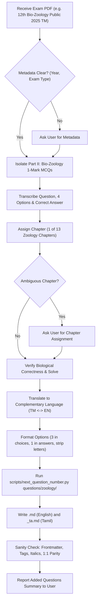

# 12th Zoology Exam PDF Parser Skill

Parses scanned, printed, or digital Class 12 Zoology and Bio-Zoology exam-paper PDFs (such as Tamil Nadu Board Public Examination, Quarterly, Half-Yearly, Revision, or District Midterm question papers) into standardized bilingual (English + Tamil) multiple-choice questions (MCQs) for the `12th-zoology_questions` repository.

---

## 1. Repository Layout & Chapter Mapping

This repository is a standalone question bank dedicated exclusively to **Tamil Nadu State Board Class 12 Zoology / Bio-Zoology**. All questions are stored as individual markdown files under `questions/zoology/<chapter>/`.

### The 13 Zoology Chapters:

| # | Chapter Directory Slug | English Chapter Title | Tamil Chapter Title (தமிழ் பாடம்) | Key Syllabus Concepts |
|---|---|---|---|---|
| 1 | `reproduction-in-organisms` | Reproduction in Organisms | உயிரினங்களின் இனப்பெருக்கம் | Asexual (fission, budding, gemmule, regeneration), sexual reproduction, parthenogenesis (arrhenotoky, thelytoky, amphitoky). |
| 2 | `human-reproduction` | Human Reproduction | மனித இனப்பெருக்கம் | Male & female reproductive systems, gametogenesis (spermatogenesis, oogenesis), menstrual cycle, fertilization, cleavage, implantation, pregnancy, parturition, lactation. |
| 3 | `reproductive-health` | Reproductive Health | இனப்பெருக்க நலன் | Contraception, barrier methods, hormonal methods, MTP, STDs/STIs, infertility, ART (IVF, ET, ZIFT, GIFT, ICSI), surrogacy, amniocentesis. |
| 4 | `principles-of-inheritance-and-variation` | Principles of Inheritance and Variation | மரபுக்கடத்தல் கோட்பாடுகள் மற்றும் மாறுபாடுகள் | Multiple alleles (ABO & Rh blood grouping), sex determination (XX-XY, XX-XO, ZZ-ZW, haplodiploidy in honeybees), sex-linked inheritance (haemophilia, colour blindness), karyotyping, Mendelian & chromosomal disorders (Down, Turner, Klinefelter). |
| 5 | `molecular-genetics` | Molecular Genetics | மூலக்கூறு மரபியல் | DNA as genetic material, DNA replication, transcription, genetic code, translation, regulation of gene expression (lac operon), Human Genome Project (HGP), DNA fingerprinting. |
| 6 | `evolution` | Evolution | பரிணாமம் | Origin of life, theories of evolution (Lamarckism, Darwinism, Mutation theory, Modern Synthetic theory), evidences (homologous, analogous, embryological), Hardy-Weinberg principle, adaptive radiation, human evolution. |
| 7 | `human-health-and-diseases` | Human Health and Diseases | மனித நலன் மற்றும் நோய்கள் | Bacterial, viral, protozoan (malaria life cycle), helminthic, fungal diseases; lifestyle diseases; drug, alcohol, and tobacco abuse; adolescence. |
| 8 | `immunology` | Immunology | நோய் தடைக்காப்பியல் | Innate & acquired immunity, lymphoid organs (primary & secondary), antigens, antibody structure (IgG, IgA, IgM, IgE, IgD), antigen-antibody interactions, hypersensitivity/allergy, autoimmune diseases, immunodeficiency (AIDS). |
| 9 | `microbes-in-human-welfare` | Microbes in Human Welfare | மனித நலனில் நுண்ணுயிரிகள் | Household products (curd, cheese, fermented beverages), industrial products (antibiotics, enzymes, organic acids), sewage treatment (STP), biogas production, biocontrol agents, biofertilizers. |
| 10 | `applications-of-biotechnology` | Applications of Biotechnology | உயிரி தொழில்நுட்பவியலின் பயன்பாடுகள் | Recombinant DNA technology, genetically engineered insulin, interferons, gene therapy, transgenic animals, stem cells, biosafety, ELISAs, PCR diagnosis. |
| 11 | `organisms-and-populations` | Organisms and Populations | உயிரினங்கள் மற்றும் இனக்கூட்டம் | Organism and environment, abiotic factors (temperature, water, light, soil), adaptations, population attributes (growth models, exponential, logistic), population interactions (mutualism, commensalism, parasitism, predation, competition). |
| 12 | `biodiversity-and-its-conservation` | Biodiversity and its Conservation | உயிரிய பல்வகைத்தன்மை மற்றும் அதன் பாதுகாப்பு | Levels of biodiversity, patterns of diversity, importance of biodiversity, loss of biodiversity (Evil Quartet), conservation methods (in-situ, ex-situ), protected areas, hotspots, IUCN red list. |
| 13 | `environmental-issues` | Environmental Issues | சுற்றுச்சூழல் பிரச்சினைகள் | Pollution (air, water, noise, soil), radioactive wastes, agrochemicals, solid waste management, greenhouse effect, global warming, ozone depletion, deforestation. |

---

## 2. Markdown Syntax & Gurukulams Design System Standards

The question files adhere strictly to the **`choose-the-best`** multiple-choice assessment standard from the **Gurukulams Design System**.

### Question File Format:

```markdown
---
tags:
  - public
  - <exam-type>
  - '<year>'
  - 1-marks
choices:
  - <distractor 1>
  - <distractor 2>
  - <distractor 3>
answers:
  - <correct answer>
---

## <Clean question statement without leading question number>

---

#### <Factual, truth-based scientific explanation and justification>
```

### Mandatory Rules for Questions:

1. **Strictly 1-Mark MCQs Only**:
   - This repository is an interactive quiz engine.
   - Only multiple-choice questions with 4 distinct options belong here.
   - Descriptive questions (2-mark short answers, 3-mark answers, 5-mark long essays) must NOT be added to this repository.
2. **`choices:` contains only the 3 incorrect options (distractors)**.
3. **`answers:` contains the single correct option**.
4. **Strip all option identifiers**:
   - Completely remove prefixes like `(a)`, `(b)`, `(c)`, `(d)`, `(A)`, `(B)`, `(C)`, `(D)`, `(1)`, `(2)`, `(3)`, `(4)`, `(i)`, `(ii)`, `(அ)`, `(ஆ)`, `(இ)`, `(ஈ)`.
   - Only retain the pure biological term, value, or statement.
5. **Headings & Structure**:
   - Level 2 heading `## ` for the question statement (strip leading number like `1. `, `15. `).
   - Exactly one horizontal rule `---` separating the question and explanation.
   - Level 4 heading `#### ` for the scientific explanation.
6. **Factual Scientific Reasoning (`#### `)**:
   - Explanations must be scientifically rigorous, citing biological mechanisms, definitions, cycles, or textbook rationale.
   - Do NOT just restate "Option A is correct". Explain *why* it is correct and *why* key alternatives are incorrect.
   - English files have explanations in English; Tamil files have explanations in Tamil.
7. **Bilingual Pairing (1:1 Parity)**:
   - For every question number `<n>`, generate both:
     - English: `questions/zoology/<chapter>/<n>.md`
     - Tamil: `questions/zoology/<chapter>/<n>_ta.md`
   - Both files must share the exact same integer `<n>`, identical `tags:`, and identical answer key correspondence.

---

## 3. Class 12 Zoology Domain Guidelines

### A. Bio-Zoology vs. Bio-Botany Paper Separation
In Tamil Nadu Higher Secondary Biology question papers:
- **Part I is Bio-Botany (உயிரி-தாவரவியல்)**.
- **Part II is Bio-Zoology (உயிரி-விலங்கியல்)**.
- **Rule**: Extract ONLY questions from **Part II (Bio-Zoology)** or from **Pure Zoology** papers. Botany questions (pollination, plant tissues, apomixis, plant breeding) must never be added to this repository.

### B. Scientific Names & Binomial Nomenclature
- All genus and species scientific names must be written in italics:
  - English: `*Plasmodium vivax*`, `*Homo sapiens*`, `*Entamoeba histolytica*`, `*Escherichia coli*`, `*Drosophila melanogaster*`.
  - Tamil: `*பிளாஸ்மோடியம் வைவாக்ஸ்*`, `*ஹோமோ சேப்பியன்ஸ்*`, `*எண்டமீபா ஹிஸ்டோலைடிகா*`.

### C. Genetics Notation & Formatting
- Alleles and blood groupings: Use superscript math notation:
  - `$I^A$`, `$I^B$`, `$i$`
  - `$X^h Y$`, `$X^h X^h$` (Haemophilia)
  - `$X^c Y$`, `$X^c X^c$` (Colour blindness)
  - Genotypes: `$AaBb$`, `$Tt$`, `$9:3:3:1$`
- KaTeX escaping rule: If writing math row separators or backslashes in markdown text, use `\\\\` to avoid CommonMark unescaping.

### D. Diagram and Image-Based Questions
If a question references an anatomical diagram, genetic pedigree, or chart:
1. Crop/save the image cleanly into `questions/zoology/<chapter>/assets/`.
2. Name the file with a valid lowercase kebab-case slug:
   - Format: `image-<qid>-p<page>.png` or `diagram-<slug>.png`
   - Regex: `^[a-z0-9]+(-[a-z0-9]+)*(_[a-z]{2})?$`
3. Reference the image using standard Markdown:
   ```markdown
   
   ```

### E. Standard Bilingual Zoology Glossary

Use official Tamil Nadu State Board Class 12 Zoology textbook terminology:

| English Term | Tamil Term (தமிழ் கலைச்சொல்) |
|---|---|
| Spermatogenesis | விந்தணுவாக்கம் |
| Oogenesis | அண்டணுவாக்கம் |
| Parthenogenesis | கன்னிப் பிறப்பு |
| Cleavage | பிளவிப்பெருகல் |
| Implantation | கருப்பதித்தல் |
| Parturition | மகப்பேறு / குழந்தை பிறப்பு |
| Contraception | கருத்தடை |
| Infertility | மலட்டுத்தன்மை |
| Assisted Reproductive Technology (ART) | உதவி பெறும் இனப்பெருக்க தொழில்நுட்பம் |
| Multiple Alleles | பல்கூட்டு அல்லீல்கள் |
| Sex-linked inheritance | பால் சார்ந்த மரபுக்கடத்தல் |
| Karyotyping | காரியோடைப்பிங் / குரோமோசோம் வரைபடத் தொகுப்பு |
| Transcription | படியெடுத்தல் |
| Translation | மொழிபெயர்த்தல் |
| Genetic code | மரபணுக் குறியீடு |
| Lac Operon | லாக் ஓபரான் (லாக்டோஸ் இயக்கி) |
| DNA Fingerprinting | டி.என்.ஏ ரேகை அச்சிடல் தொழில்நுட்பம் |
| Homologous organs | அமைப்பொத்த உறுப்புகள் |
| Analogous organs | செயலொத்த உறுப்புகள் |
| Adaptive radiation | தகவமைப்புப் பரவல் |
| Natural selection | இயற்கை தேர்வு |
| Antigen | எதிர்ப்பொருள் தூண்டி / ஆன்டிஜென் |
| Antibody | எதிர்ப்பொருள் / ஆன்டிபாடி |
| Innate immunity | இயல்பு நோய் எதிர்ப்புத் திறன் |
| Acquired immunity | பெறப்பட்ட நோய் எதிர்ப்புத் திறன் |
| Autoimmune disease | சுய நோய் எதிர்ப்பு நோய் |
| Recombinant DNA (rDNA) | மறுசேர்க்கை டி.என்.ஏ |
| Transgenic animal | மரபணு மாற்றப்பட்ட விலங்கு |
| Bioreactor | உயிரி வினைகலன் |
| Population density | இனக்கூட்ட அடர்த்தி |
| Mutualism | முதலீட்டுயிர் வாழ்க்கை / ஒருங்கமைவு (மியூச்சுவலிசம்) |
| Commensalism | உடன் உண்ணும் வாழ்க்கை (கமென்சலிசம்) |
| Biodiversity Hotspot | உயிரிய பல்வகைத்தன்மை வளம் நிறைந்த பகுதி |
| In-situ conservation | உள்வாழிடப் பாதுகாப்பு |
| Ex-situ conservation | வெளிவாழிடப் பாதுகாப்பு |
| Eutrophication | யூட்ரோபிகேஷன் (மிகை ஊட்டமுறுதல்) |
| Biomagnification | உயிரிய உருப்பெருக்கம் |

---

## 4. Sequential Question Numbering Workflow

To maintain clean sequential IDs without collisions across contributors:

1. **Determine the Next Integer**:
   Run the helper script from the repository root:
   ```bash
   python3 scripts/next_question_number.py questions/zoology/<chapter-folder>
   # Example:
   python3 scripts/next_question_number.py questions/zoology/human-reproduction
   ```
2. **Assign Number**:
   - If the script outputs `5`, create:
     - English: `questions/zoology/human-reproduction/5.md`
     - Tamil: `questions/zoology/human-reproduction/5_ta.md`
3. **Never Overwrite or Renumber**:
   - Existing question files must NEVER be overwritten or re-ordered.
   - Always append sequentially.

---

## 5. Ambiguity Protocol (Always Ask Before Proceeding)

If any ambiguity occurs, **STOP and ask the user for confirmation**:

1. **Ambiguous Chapter Classification**:
   - E.g., whether a question on sickle cell anemia belongs to `principles-of-inheritance-and-variation` (Mendelian disorder) or `human-health-and-diseases` (genetic disease).
2. **Missing or Incomplete Paper Metadata**:
   - If the PDF does not clearly state the year, exam type (Quarterly, Half-Yearly, Public), or medium.
3. **Biological / Typographical Errors in Exam Paper**:
   - If an exam paper question has multiple correct options, no correct options, or factual typos, flag the issue clearly to the user, propose the textbook-accurate correction, and wait for confirmation.
4. **Botany vs. Zoology Boundary Questions**:
   - E.g., questions on generalized Mendelian genetics crosses or biotechnology tools (PCR, plasmids) that appear in Botany sections. Clarify before adding.

---

## 6. End-to-End Execution Flow



### Checklist for Each Question Pair:
- [ ] Belongs to Zoology (not Botany).
- [ ] `tags:` contains exam type (e.g. `public`, `quarterly`, `half-yearly`), year in single quotes (e.g. `'2025'`), and `1-marks`.
- [ ] `choices:` contains exactly 3 incorrect distractors.
- [ ] `answers:` contains exactly 1 correct answer.
- [ ] Option letters `(a)`, `(b)`, `(c)`, `(d)`, `(A)`, `(B)`, `(அ)`, `(ஆ)` are completely stripped.
- [ ] Scientific names are in italics (`*Genus species*`).
- [ ] Question header is `## ` and explanation header is `#### `.
<<<<<<< HEAD
- [ ] English and Tamil files have identical `<n>` number and identical frontmatter tags.
=======
- [ ] English and Tamil files have identical `<n>` number and identical frontmatter tags.
>>>>>>> 21955a50012a90ea1685b6067108ce0ccb2882f8
