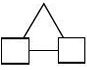

In which type of Parthenogenesis are only males produced ?
- Arrhenotoky
- Thelytoky
- Amphitoky
- Both (a) and (c)

Statement I : Castration (or) surgical removal of testis is known as Orchidectomy.

Statement II : It leads to difficulty in urination.
- Statement I and Statement II are not correct.
- Statement I and II are correct.
- Statement I is not correct and Statement II is correct.
- Statement I is correct and Statement II is not correct.

Select the incorrect action of hormonal contraceptive pills from the following.
- Changes in cervical mucus impairing its ability to allow passage and transport of sperms
- Inhibition of spermatogenesis
- Alteration in uterine endometrium to make it unsuitable for implantation
- Inhibition of ovulation

This pedigree symbol represents:

- Male
- Monozygotic twins
- Mating
- Dizygotic twins

Hershey and Chase’s experiment with bacteriophage showed that :
- DNA contains radioactive sulphur.
- Protein gets into the bacterial cells.
- Viruses undergo transformation.
- DNA is the genetic material.

Find out the wrongly matched pair.
- Y-chromosome - 231 genes
- Chromosome-1 - 2968 genes
- Dystrophin - 2.4 million bases
- Human genome - 300 bases

The wings of birds and butterflies is an example of :
- Divergent evolution
- Adaptive radiation
- Variation
- Convergent evolution

Which of the following groups of diseases have been controlled by the use of vaccines and by creating awareness among the people ?
- Small pox, amoebiasis, diphtheria, tetanus.
- Small pox, polio, diphtheria, tetanus.
- Small pox, AIDS, diphtheria, tetanus.
- Small pox, common cold, diphtheria, tetanus.

Allergy involves :
- IgA
- IgE
- IgM
- IgG

The most common substrate used in distilleries for the production of ethanol is ________.
- Molasses
- Soya meal
- Corn meal
- Groundgram

Assertion (A) : In nature many organisms produce clones through asexual reproduction.

Reason (R) : By this process, genetically identical individuals are produced.
- Both Assertion and Reason are false.
- Assertion is true, but Reason is false.
- Both Assertion and Reason are true but Reason is not the correct explanation of Assertion.
- Both Assertion and Reason are true and Reason explains Assertion correctly.

The relationship between sucker fish and shark is __________.
- Predation
- Competition
- Parasitism
- Commensalism

The term “Niche” was first used by __________.
- John Ray
- Charles Darwin
- Jordon
- Charles Elton

Which one of the following are at higher risk of extinction due to habitat destruction ?
- Amphibians
- Mammals
- Echinoderms
- Birds

__________ is/are an ideal disinfectant for waste water.
- Boiling
- U-V Rays
- Ozonisation
- Chlorination
