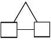

எவ்வகைக் கன்னி இனப்பெருக்கத்தில் ஆண் உயிரிகள் மட்டுமே உருவாகின்றன ?
- அர்ரினோடோக்கி
- தெலிடோக்கி
- ஆம்பிடோக்கி
- (அ) மற்றும் (இ) இரண்டும்

கூற்று I : அறுவை சிகிச்சை மூலம் விரைகளை நீக்குதல் (அல்லது) ஆண் மலடாக்கம் 'ஆர்க்கிடெக்டமி' எனப்படும்.

கூற்று II : இதனால் சிறுநீர் கழித்தல் கடினமாகிறது.
- கூற்று I மற்றும் கூற்று II இரண்டும் தவறு.
- கூற்று I மற்றும் கூற்று II இரண்டும் சரி.
- கூற்று I தவறு ஆனால் கூற்று II சரி.
- கூற்று I சரி ஆனால் கூற்று II தவறு.

கீழ்வருவனவற்றுள் ஹார்மோன் கருத்தடை மாத்திரைகளின் செயல்கள் பற்றிய தவறான கூற்றைத் தேர்ந்தெடுக்க.
- கருப்பைவாய் கோழையின் தன்மை மாற்றத்தால் விந்துசெல் நுழையும் பாதை மற்றும் விந்துசெல் நகர்வதைக் நல்காமல் தடைசெய்தல்
- விந்து செல்லாக்கத்தை தடை செய்தல்
- கருப்பை உட்சுவரைப் படலத்தில் ஏற்படும் மாற்றம் கருப்பதிவிற்கு எதிரான சூழலை ஏற்படுத்துகிறது.
- அண்ட வெளியீட்டை தடை செய்தல்

 இந்த மரபுக் குறியீடு எதைக் குறிக்கிறது ?
- ஆண்
- ஒற்றைக்கு ஒத்த இரட்டையர்கள்
- கலப்பு
- இரட்டைக்கு ஒத்த இரட்டையர்கள்

ஹெர்ஷே மற்றும் சேஸ் ஆய்வோர் பாக்டீரியோபேஜில் செய்த ஆய்வு எதனைக் காட்டுகிறது ?
- டி.என்.ஏ -வில் கதிரியக்கத் தன்மையுடைய கந்தகம் உள்ளது
- புரதம், பாக்டீரியா செல்லுக்குள் நுழைகிறது
- வைரஸ்கள் உருமாற்றம் அடையும்
- டி.என்.ஏ ஒரு மரபுப்பொருள்

தவறாகப் பொருந்தியுள்ளவற்றைத் தேர்ந்தெடு.
- Y-குரோமோசோம் - 231 மரபணுக்கள்
- 1 -வது குரோமோசோம் - 2968 மரபணுக்கள்
- டிஸ்ட்ரோபின் - 2.4 மில்லியன் கார மூலங்கள்
- மனித ஜீனோம் - 300 கார மூலங்கள்

பறவைகள் மற்றும் வண்ணத்துப்பூச்சிகளின் இறக்கைகள் கீழ்க்கண்ட எதற்கு எடுத்துக்காட்டுகளாகும் ?
- விரி பரிணாமம்
- பரவல் முறை தகவமைப்பு
- மாறுபாடுகள்
- குவி பரிணாமம்

தடுப்பூசிகளை பயன்படுத்தியதாலும், மக்களிடையே விழிப்புணர்வை ஏற்படுத்தியதாலும் கட்டுப்படுத்தப்பட்ட நோய்களின் குழுவைக் கண்டறிக.
- பெரியம்மை, அமீபியாசிஸ், டிப்தீரியா, டெட்டனஸ்
- பெரியம்மை, இளம்பிள்ளைவாதம், டிப்தீரியா, டெட்டனஸ்
- பெரியம்மை, எய்ட்ஸ், டிப்தீரியா, டெட்டனஸ்
- பெரியம்மை, சாதாரண சளி, டிப்தீரியா, டெட்டனஸ்

ஒவ்வாமையில் தொடர்புடையது :
- IgA
- IgE
- IgM
- IgG

வடிசாலைகளில் எத்தனால் உற்பத்திக்கு பயன்படுத்தப்படும் பொதுவான தளப்பொருள் ________.
- கரும்பாலைக் கழிவுகள்
- சோயா மாவு
- சோள உணவு
- நிலக்கடலை

கூற்று (A) : இயற்கையில் பல உயிரினங்கள் நகலாக்கம் எனும் பாலிலி இனப்பெருக்க முறையை மேற்கொள்கின்றன.

காரணம் (R) : இதன் மூலம் மரபொத்த உயிரிகள் உருவாக்கப்படுகின்றன.
- கூற்று மற்றும் காரணம் இரண்டும் தவறு.
- கூற்று சரி, ஆனால் காரணம் தவறு.
- கூற்று மற்றும் காரணம் சரி ஆனால் காரணம் கூற்றிற்கு சரியான பொருத்தமில்லை.
- கூற்று மற்றும் காரணம் இரண்டும் சரி, கூற்று காரணத்திற்குச் சரியாகப் பொருந்துகிறது.

உறிஞ்சுமீனுக்கும் சுறாமீனுக்கும் உள்ள தொடர்பு :
- வேட்டையாடும் வாழ்க்கை
- போட்டி
- ஒட்டுண்ணி வாழ்க்கை
- உதவிபெறும் வாழ்க்கை

'சிறுவாழிடம்' என்ற சொல்லை முதன் முதலில் பயன்படுத்தியவர் :
- ஜான் ரே
- சார்லஸ் டார்வின்
- ஜோர்டான்
- சார்லஸ் எல்டன்

வாழிட சீரழிவினால் மிகக் கடுமையான பாதிப்புகளுக்கு உள்ளாகி அழியும் நிலையில் உள்ள உயிரினம் எது ?
- இருவாழ்விகள்
- பாலூட்டிகள்
- முட்தோலிகள்
- பறவைகள்

__________ ஒரு சிறந்த தொற்று நீக்கியாக கழிவுநீர் சுத்திகரிப்பில் பயன்படுத்தப்படுகிறது.
- கொதிக்க வைத்தல்
- புற ஊதாக் கதிர்கள்
- ஓசோன் சேர்த்தல்
- குளோரின் இடுதல்
