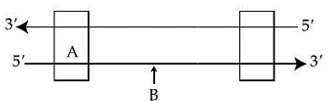

Define Regeneration.

What is Assisted Reproductive Technology (ART) ?

Write any two applications of Karyotyping.

Rearrange the descent in human evolution. Australopithecus → Homo erectus → Homo sapiens → Ramapithecus → Homo habilis.

Name the parts marked A and B in the given transcription unit.

Write a short note on Ideonella sakaiensis.
