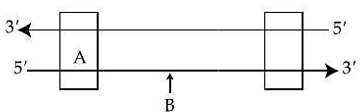

இழப்பு மீட்டல் - வரையறுக்கவும்.

இனப்பெருக்க துணை தொழில் நுட்பம் என்றால் என்ன ?

குரோமோசோம் தொகுப்பு வரைபடத்தின் ஏதேனும் இரண்டு பயன்களை எழுதுக.

மனித இனத்தின் பரிணாமத் தோற்றத்தின் நிலைகளை கீழ்நோக்கு வரிசையில் வரிசைப்படுத்துக. ஆஸ்ட்ரலோபித்திகஸ் → ஹோமோ ஏரக்டஸ் → ஹோமோ சேப்பியன்ஸ் → ராமாபித்திகஸ் → ஹோமோ ஹாபிலிஸ்.

கீழ்க்கண்ட படியெடுத்தல் அலகில் A மற்றும் B எனக் குறிக்கப்பட்டுள்ளவற்றை எழுதுக.

இடியோனெல்லா சாக்கையன்சிஸ் பற்றி சிறு குறிப்பு எழுதுக.
