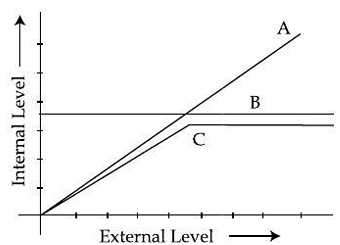

# Questions

## 1 Mark

A person is injured and got swelling. The swelling, due to the infection of tissue is an example of :
- Phagocytosis
- Mechanical barrier
- Inflammation
- Physiological barrier

The first codon to be deciphered was __________ which codes for __________.
- UUU, Phenylalanine
- AAA, Proline
- TTT, Arginine
- GGG, Alanine

Find out the wrongly matched pair.
- Klinefelter’s Syndrome - XXY Female
- Down’s Syndrome - Trisomy-21
- Turner’s Syndrome - XO Female
- Patau’s Syndrome - Trisomy-13

The Neanderthal man had the brain capacity of :
- 900 cc
- 650-800 cc
- 1400 cc
- 1200 cc

Which one of the following groups includes sexually transmitted diseases caused by bacteria only ?
- Syphilis, gonorrhoea and trichomoniasis
- Syphilis, gonorrhoea and candidiasis
- Syphilis, trichomoniasis and pediculosis
- Syphilis, chlamydiasis and gonorrhoea

ELISA is mainly used for :
- Selecting animals having desired traits
- Detection of mutations
- Selecting plants having desired traits
- Detection of pathogens

The most important hormone in initiating and maintaining lactation after birth is :
- Prolactin
- Oestrogen
- Oxytocin
- FSH

Assertion : The Environmental conditions of the Tropics are favourable for speciation and diversity of organisms.

Reason : The climatic seasons, temperature, humidity and photo period are more or less stable and congenial.

- Assertion is true, but Reason is false.
- Both Assertion and Reason are true and Reason explains Assertion correctly.
- Both Assertion and Reason are false.
- Both Assertion and Reason are true but Reason is not the correct explanation of Assertion.

The figure given below is a diagrammatic representation of response of organisms to abiotic factors. What do A, B and C represent respectively ?

- A: Partial Regulator, B: Regulator, C: Conformer
- A: Conformer, B: Regulator, C: Partial Regulator
- A: Regulator, B: Conformer, C: Partial Regulator
- A: Regulator, B: Partial Regulator, C: Conformer

The mode of sexual reproduction in bacteria is by :
- Conjugation
- Formation of gametes
- Zoospore formation
- Endospore formation

The headquarters of the National Biodiversity Authority is situated in __________.
- Delhi
- Mumbai
- Kolkata
- Chennai

The clusters of gene with related functions are called as __________.
- Recons
- Mutons
- Operons
- Cistrons

Which of the following micro-organisms is used for production of citric acid in Industries ?
- Aspergillus niger
- Lactobacillus bulgaris
- Rhizopus nigricans
- Penicillium citrinum

The ‘thickness’ of Stratospheric Ozone layer is measured in :
- Melson units
- Sieverts units
- Beaufort scale
- Dobson units

Haemozoin is :
- A toxin from Plasmodium species
- A precursor of haemoglobin
- A toxin from Haemophilus species
- A toxin from Streptococcus

## 2 Mark

What is ectopic pregnancy ?

Draw and mention the parts of a spermatozoan.

Give any two applications of DNA finger printing.

List out the major gases seems to be found in the primitive earth.

Rearrange the descent in human evolution.

Australopithecus → Homo erectus → Homo sapiens → Ramapithecus → Homo habilis

How does Saliva act in body defence ?

Give any two bioactive molecules produced by microbes and state their uses.

What is Acclimatisation ?

Differentiate Natality and Mortality.

## 3 Mark

Differentiate Fission and Fragmentation with suitable examples.

Give the expansion for the following.
- ZIFT
- ICSI
- IUT

What is criss-cross inheritance ? Give example.

If the coding sequence in a transcription unit is written as follows :

5' TGCATGCATGCATGCATGCATGCATGC 3'

Write down the nucleotide sequence of mRNA.

Complete the following table.

| Diseases | Causative agent | Site of infections |
|---|---|---|
| Mumps | | |
| Chicken pox | | |
| Dengue fever | | |

What is bioremediation ? Mention their types.

Gene Therapy is an attempt to correct a Genetic defect by providing a normal gene into the individual. By this the function can be restored.

An alternate method could be to provide gene product known as enzyme replacement therapy, which would also restore the function.

Which in your opinion is a better option ?

Give reasons for your answer.

How many HOTSPOTS are there in INDIA ? Name them.

What is meant by agrochemicals ? Mention any 2 (Two) effects of over usage of agrochemicals.

## 5 Mark

Explain the structure of the Human ovary.

Explain the genetic basis of ABO Blood grouping in man.

Write about incompatibility of Rh factor and how it can be prevented ?

Explain the three level of impact of extinction of species.

Mention any five salient features of Human Genome Project.

Suggest some ways to prevent drug and alcohol abuse.

Explain the structure of immunoglobulin with suitable diagram.

List the adaptations seen in terrestrial animals.

Differentiate between r-selected and k-selected species.

Write short notes on :
- Protected areas
- Wild life sanctuaries
- WWF