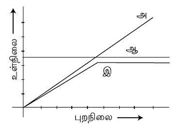

# Questions

## 1 Mark

ஒருவருக்கு அடிபட்டு காயம் ஏற்படுகிறது. திசு சிதைவினால் உருவாகும் இந்த காயம் கீழ்க்கண்டவற்றுள் எதற்கு எடுத்துக்காட்டாகும்.
- பேகோசைட்டோசிஸ்
- இயற்பியல் தடைக்காப்பு
- வீக்கம்
- உடற்செயல் சார்ந்த தடைக்காப்பு

முதன் முதலில் பொருள் கண்டறியப்பட்ட கோடான் ______ ஆகும். இது ______ அமினோ அமிலத்திற்கான குறியீடு ஆகும்.
- UUU, ஃபீனைல் அலனின்
- AAA, புரோலைன்
- TTT, அர்ஜினைன்
- GGG, அலனைன்

தவறாக பொருந்தியுள்ளவற்றை தேர்ந்தெடு.
- கிளைன்ஃபெல்டர் சிண்ட்ரோம் - XXY பெண்கள்
- டவுன் சிண்ட்ரோம் - 21 ட்ரைசோமி
- டர்னர் சிண்ட்ரோம் - XO பெண்கள்
- பட்டாவ் சிண்ட்ரோம் - 13 ட்ரைசோமி

நியாண்டர்தால் மனிதனின் மூளை அளவு :
- 900 க.செ.மீ.
- 650 - 800 க.செ.மீ.
- 1400 க.செ.மீ.
- 1200 க.செ.மீ.

கீழ் உள்ள குழுக்களில், பாக்டீரிய பால்வினை நோய்க் குழுவைக் குறிப்பிடுக.
- சிபிலிஸ், கொனோரியா, டிரைக்கோமோனியாசிஸ்
- சிபிலிஸ், வெட்டைநோய் மற்றும் கேண்டிடியாசிஸ்
- சிபிலிஸ், டிரைக்கோமோனியாசிஸ், பெடிகுலோசிஸ்
- சிபிலிஸ், கிளாமிடியாசிஸ், வெட்டைநோய்

எலைசா முதன்மையாக __________ பயன்படுத்தப்படுகிறது.
- விரும்பத்தக்க பண்புகளை கொண்ட விலங்குகளைத் தேர்வு செய்ய
- திடீர் மாற்றங்களைக் கண்டறிய
- விரும்பத்தக்க பண்புகளையுடைய தாவரங்களைத் தேர்வு செய்ய
- நோய்க்கிருமிகளைக் கண்டறிய

குழந்தை பிறப்புக்குப்பின் பால் சுரத்தலைத் தொடங்கி வைப்பதும் தொடர்ச்சியாக சுரக்க வைக்கவும் உதவும் முக்கிய ஹார்மோன் :
- புரோலாக்டின்
- ஈஸ்ட்ரோஜன்
- ஆக்ஸிடோசின்
- FSH

கூற்று : வெப்பமண்டல பகுதிகளில் நிலவும் சுற்றுச்சூழல் தன்மைகள் உயிரினங்களின் சிற்றினமாக்கல் மற்றும் பல்வகைத் தன்மைக்குச் சாதகமாக உள்ளன.

காரணம் : பருவகாலம், தட்பவெப்பநிலை, ஈரப்பதம் மற்றும் ஒளிக்காலம் ஆகியவை ஏறக்குறைய நிலையானவையாகவும், உகந்ததாகவும் உள்ளது.

- கூற்று சரி ஆனால் காரணம் தவறு.
- காரணம் மற்றும் கூற்று இரண்டும் சரி, காரணம் கூற்றை சரியாக விளக்குகிறது.
- கூற்று மற்றும் காரணம் இரண்டும் தவறு.
- கூற்று மற்றும் காரணம் இரண்டும் சரி ஆனால் காரணம் கூற்றை சரியாக விளக்கவில்லை.

கீழ்க்காணும் வரைபடம் சுற்றுச்சூழலின் உயிரற்ற காரணிகளுக்கேற்ப உயிரினங்களின் எதிர்வினையைக் குறிக்கிறது. இதில் அ, ஆ மற்றும் இ எனக் குறிக்கப்பட்டுள்ளவற்றைக் கண்டறிக.

- அ: பகுதி ஒழுங்கமைவாளன், ஆ: ஒழுங்கமைவாளன், இ: ஒத்தமைவான்
- அ: ஒத்தமைவான், ஆ: ஒழுங்கமைவாளன், இ: பகுதி ஒழுங்கமைவாளன்
- அ: ஒழுங்கமைவாளன், ஆ: ஒத்தமைவான், இ: பகுதி ஒழுங்கமைவாளன்
- அ: ஒழுங்கமைவாளன், ஆ: பகுதி ஒழுங்கமைவாளன், இ: ஒத்தமைவான்

பாக்டீரியாவில் பால் இனப்பெருக்கம் கீழ்க்கண்ட எந்த முறையில் நடைபெறுகிறது ?
- இணைதல்
- கேமீட் உருவாக்கம்
- சூஸ்போர் உருவாக்கம்
- எண்டோஸ்போர் உருவாக்கம்

தேசிய உயிரியல் பன்மைத்தன்மை ஆணையத்தின் தலைமையகம் எங்கு அமைந்துள்ளது ?
- டெல்லி
- மும்பை
- கொல்கத்தா
- சென்னை

தொடர்புடைய வேலைகளைச் செய்கிற மரபணு கூட்டத்திற்கு __________ என்று பெயர்.
- ரெக்கான்கள்
- மியூட்டான்கள்
- ஓபரான்கள்
- சிஸ்ட்ரான்கள்

கீழ்க்கண்டவற்றுள் எந்த நுண்ணுயிரி, தொழிற்சாலைகளில் சிட்ரிக் அமில உற்பத்திக்கு பயன்படுத்தப்படுகிறது ?
- ஆஸ்பர்ஜில்லஸ் நைஜர்
- லாக்டோபேசில்லஸ் பல்காரிஸ்
- ரைசோபஸ் நைக்ரிகன்ஸ்
- பெனிசிலியம் சிட்ரினம்

ஸ்ட்ரேட்டோஸ்பியரின் ஓசோன் அடுக்கின் தடிமனை அளவிட பயன்படுத்துவது __________.
- மெல்சன் அலகு
- சிவர்ட்ஸ் அலகு
- பியூபோர்ட் அளவுகோல்
- டாப்சன் அலகு

ஹீமோசோயின் என்பது :
- பிளாஸ்மோடியம் இனத்திலிருந்து வெளிப்படும் நச்சு
- ஹீமோகுளோபினின் முன்னோடி
- ஹீமோபிலஸ் இனத்திலிருந்து வெளிப்படும் நச்சு
- ஸ்ட்ரெப்டோகாக்கஸ் இனத்திலிருந்து வெளிப்படும் நச்சு

## 2 Mark

இடம் மாறிய கர்ப்பம் என்றால் என்ன ?

முதிர்ந்த விந்தணுவின் படம் வரைந்து பாகங்களைக் குறிக்கவும்.

டி.என்.ஏ ரேகை அச்சிடலின் பயன்பாடுகளில் ஏதேனும் இரண்டினைத் தருக.

தொன்மையான பூமியில் காணப்பட்ட வாயுக்களைப் பட்டியலிடுக.

மனித இனத்தின் பரிணாமத் தோற்றத்தின் நிலைகளை கீழ்நோக்கு வரிசையில் வரிசைப்படுத்துக.

ஆஸ்ட்ரலோபிதிகஸ் → ஹோமோ எரக்டஸ் → ஹோமோ சேப்பியன்ஸ் → ராமாபித்திகஸ் → ஹோமோ ஹாபிலிஸ்

மனித உடலின் பாதுகாப்பில் உமிழ்நீர் எவ்வாறு செயல்படுகிறது ?

நுண்ணுயிரிகளால் உற்பத்தி செய்யப்படும் உயிரிய செயல் திறனுள்ள மூலக்கூறுகள் இரண்டினையும், அவற்றின் பயன்களையும் கூறுக.

புதிய சூழலுக்கு இணங்குதல் என்றால் என்ன ?

பிறப்பு வீதம் மற்றும் இறப்பு வீதம் என்றால் என்ன ?

## 3 Mark

பிளவாதல் மற்றும் துண்டாதல் ஆகியவற்றை தகுந்த எடுத்துக்காட்டுடன் வேறுபடுத்துக.

கீழ்க்கண்டவற்றிற்கான விரிவாக்கம் தருக.
- ZIFT
- ICSI
- IUT

குறுக்கு மரபுக் கடத்தல் என்றால் என்ன ? எடுத்துக்காட்டு தருக.

கீழ்க்காணும் படியெடுத்தல் அலகிற்கான குறியீட்டு வரிசை எழுதப்பட்டுள்ளவாறு :

5' TGCATGCATGCATGCATGCATGCATGC 3'

உருவாக்கப்படும் தூது RNA-வின் நியூக்ளியோடைடு வரிசையை எழுதுக.

கீழ்க்காணும் அட்டவணையை நிறைவு செய்க.

| நோய்கள் | நோய்க்காரணி | நோய்த்தொற்றும் இடம் |
|---|---|---|
| புட்டாளம்மை | | |
| சின்னம்மை | | |
| டெங்கு காய்ச்சல் | | |

உயிரிய தீர்வு என்றால் என்ன ? அதன் வகைகளைக் கூறுக.

ஒரு உயிரியில் மரபணு சிகிச்சை முறை மூலம் இயல்பான மரபணுக்களை வழங்கி மரபியல் குறைபாடுகளை சரிசெய்ய முயல்கின்றனர். இதனால் உயிரியின் செயல்பாடுகள் மீட்புபெறுகின்றன.

இதற்கு மாற்றாக மரபணுவின் உற்பத்திப் பொருளான நொதி மாற்று சிகிச்சை முறை மூலம் உயிரியின் செயல்பாடுகள் மீட்புபெறுகின்றன.

மேற்கூறியிட்ட இரண்டு முறைகளில் சிறந்தது எது என நீங்கள் கருதுகிறீர்கள் ?

தங்கள் கருத்துக்கான காரணங்களைக் குறிப்பிடவும்.

இந்தியாவிலுள்ள மிகை உள்ளூர் உயிரினப் பகுதிகள் எத்தனை ? அவற்றை பெயரிடுக.

வேளாண் வேதிப்பொருட்கள் என்றால் என்ன ? அவற்றை அதிகமாகப் பயன்படுத்துவதால் ஏற்படும் விளைவுகள் ஏதேனும் இரண்டினைக் குறிப்பிடுக.

## 5 Mark

மனித அண்டத்தின் அமைப்பை விளக்குக.

மரபு அடிப்படையில் மனிதனின் ABO இரத்த வகையை விவரிக்கவும்.

Rh - காரணி இணக்கமின்மை பற்றி எழுதுக. அவற்றை எவ்வாறு தடுக்கலாம் ?

சிற்றினங்கள் அழிவதால் ஏற்படும் மூன்று தாக்க நிலைகளை விவரிக்கவும்.

மனித மரபணு திட்டத்தின் சிறப்பியல்புகள் ஏதேனும் ஐந்தினைக் குறிப்பிடுக.

போதை மற்றும் மதுவை வரையறையின்றி பயன்படுத்துவதைக் தடுக்க சில வழிகளை பரிந்துரை செய்க.

இம்மியூனோகுளோபுலின் அமைப்பை தகுந்த படத்துடன் விளக்குக.

நிலவாழ் உயிரினங்களில் காணப்படும் தகவமைப்புகளை விளக்குக.

r-தேர்வு செய் மற்றும் k-தேர்வு செய் சிற்றினங்களுக்கிடையே உள்ள வேறுபாடுகளைக் கூறுக.

சிறு குறிப்புவரைக :
- பாதுகாக்கப்பட்ட பகுதிகள்
- வனவிலங்கு சரணாலயங்கள்
- WWF