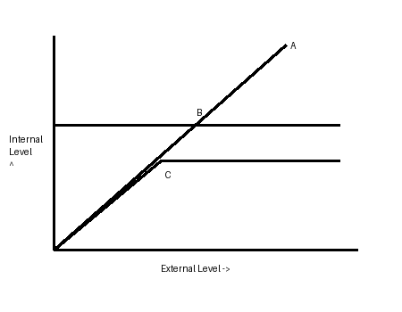

---
tags:
  - public
  - '2025'
  - 1-marks
choices:
  - A: Partial Regulator, B: Regulator, C: Conformer
  - A: Regulator, B: Conformer, C: Partial Regulator
  - A: Regulator, B: Partial Regulator, C: Conformer
answers:
  - A: Conformer, B: Regulator, C: Partial Regulator
---

## The diagrammatic representation shows the response of organisms to abiotic factors. Identify what A, B and C represent :\n\n

---

#### Line A represents Conformers whose internal body conditions change directly with external changes. Line B represents Regulators that maintain constant internal homeostasis regardless of the environment. Line C represents Partial Regulators.
