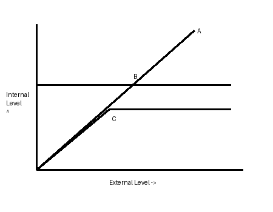

---
tags:
  - public
  - '2025'
  - 1-marks
choices:
  - அ: பகுதி ஒழுங்கமைவான், ஆ: ஒழுங்கமைவான், இ: ஒத்தமைவான்
  - அ: ஒழுங்கமைவான், ஆ: ஒத்தமைவான், இ: பகுதி ஒழுங்கமைவான்
  - அ: ஒழுங்கமைவான், ஆ: பகுதி ஒழுங்கமைவான், இ: ஒத்தமைவான்
answers:
  - அ: ஒத்தமைவான், ஆ: ஒழுங்கமைவான், இ: பகுதி ஒழுங்கமைவான்
---

## சுற்றுச்சூழல் உயிரற்ற காரணிகளுக்கேற்ப உயிரினங்களின் எதிர்வினையைக் குறிக்கும் வரைபடத்தில் A, B மற்றும் C எவற்றைக் குறிக்கின்றன ?\n\n

---

#### வரைபடத்தில் கோடு A என்பது புறச்சூழலுக்கு ஏற்ப உடல்நிலையை மாற்றிக் கொள்ளும் ஒத்தமைவானையும் (Conformers), கோடு B என்பது மாறா உள் சூழலைப் பேணும் ஒழுங்கமைவானையும் (Regulators), கோடு C என்பது பகுதி ஒழுங்கமைவானையும் (Partial regulators) குறிக்கும்.
