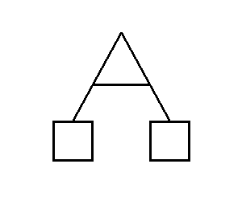

---
tags:
  - public
  - '2026'
  - 1-marks
choices:
  - Male
  - Mating
  - Dizygotic twins
answers:
  - Monozygotic twins
---

## This pedigree symbol represents :\n\n

---

#### In genetic pedigree analysis, a single line descending from parents that bifurcates to two offspring of the same sex with a horizontal connecting bar represents monozygotic (identical) twins. Without the horizontal bar, it designates dizygotic twins.
