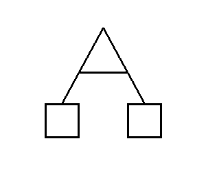

---
tags:
  - public
  - '2026'
  - 1-marks
choices:
  - ஆண்
  - கலப்பு
  - இரட்டைக்கு ஒத்த இரட்டையர்கள்
answers:
  - ஒற்றைக்கு ஒத்த இரட்டையர்கள்
---

## இந்த மரபுக் குறியீடு எதைக் குறிக்கிறது ?\n\n

---

#### பாரம்பரிய மரபு வரைபடத் தொகுப்பில் (Pedigree chart), ஒரே புள்ளியிலிருந்து பிரியும் இரு கிளைகளை ஒரு கிடைமட்டக் கோடு இணைத்திருப்பது ஒருகரு இரட்டையர்களை அல்லது ஒற்றைக்கு ஒத்த இரட்டையர்களைக் (Monozygotic twins) குறிக்கும்.
